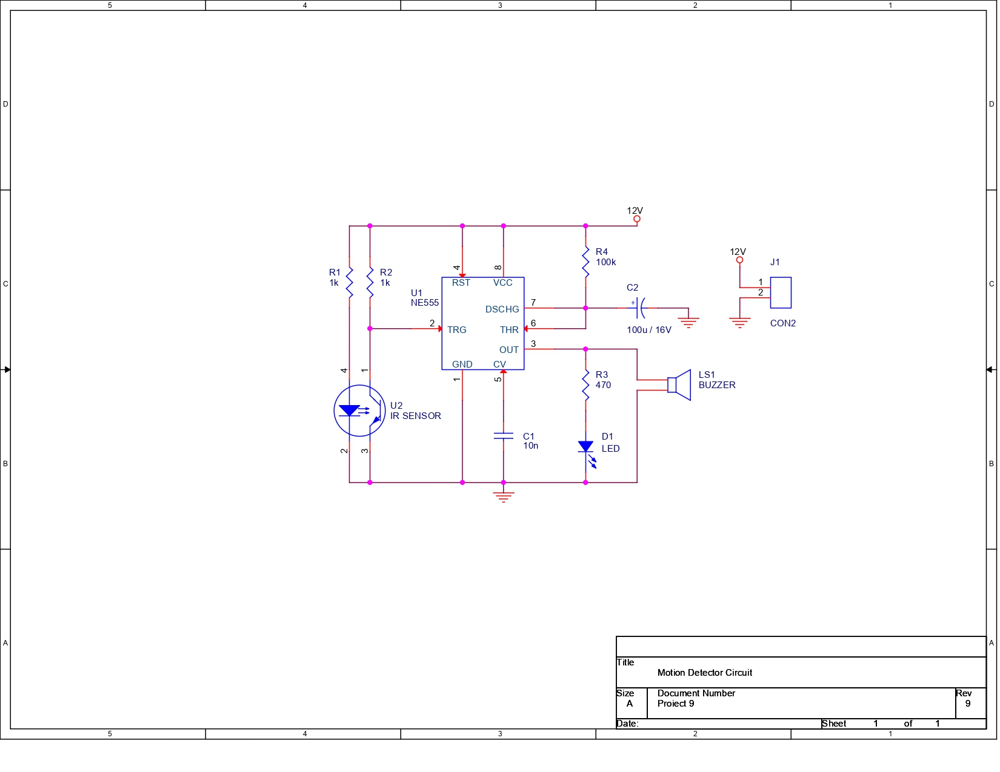
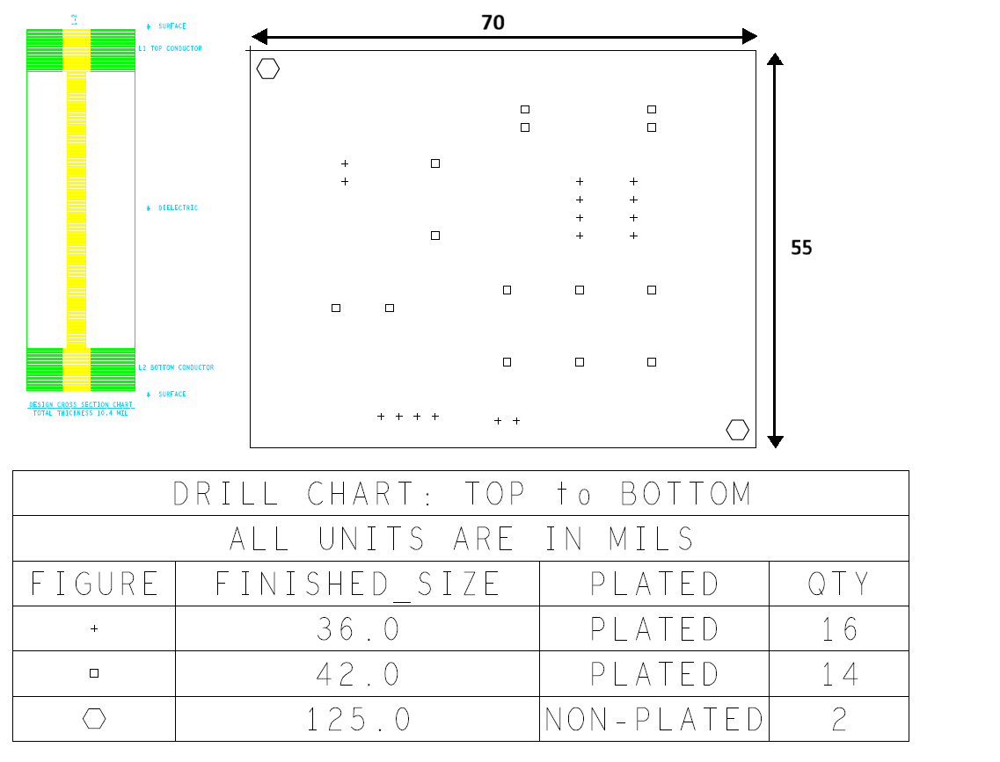

# Motion Detector – Hardware & PCB Design

Complete hardware design project for a motion detector circuit, developed using **Cadence OrCAD Capture** and **Allegro PCB Editor**.

## Project Overview
This repository contains the full design workflow from schematic capture to manufacturing outputs:
* **Schematic Design:** Created in OrCAD Capture (`CADENCE_SCH.DSN`) with full DRC verification.
* **PCB Layout:** 2-layer board routed in Allegro PCB Editor (`CADENCE_PCB.brd`).
* **Manufacturing Outputs:** Gerber files (`TOP.art`, `BOTTOM.art`), NC Drill (`CADENCE_PCB-1-2.drl`), assembly drawings, and Bill of Materials (`bom_avansat.xlsx`).
* **Mechanical & Documentation:** Mechanical design overview and technical documentation.

## Preview

### Electrical Schematic

### Mechanical Design

## Tools Used
* **OrCAD Capture** – Schematic design & netlist generation
* **Allegro PCB Editor** – PCB layout, routing & Gerber export
